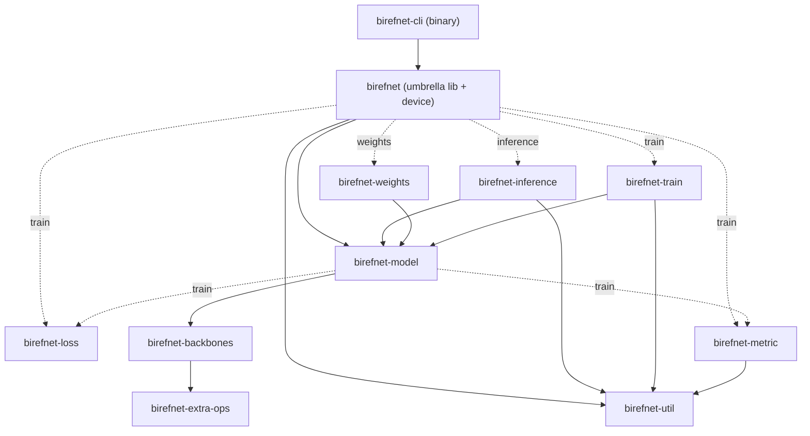

# Architecture and Design Decisions

## Workspace Crate Graph

The workspace is split into 11 crates so low-level tensor utilities, backbones, losses, and metrics
can be built and tested independently without pulling in CLI or Hub dependencies.

Dashed edges indicate optional Cargo features (`weights`, `inference`, `train`).

### Crate Feature Boundaries

| Crate                | Optional Features                                                  | Notes                                                           |
| -------------------- | ------------------------------------------------------------------ | --------------------------------------------------------------- |
| `birefnet`           | `weights`, `hub`, `inference`, `train`, `flex`, `cpu`, `wgpu`, `vulkan`, `metal`, `cuda`, `rocm`, `fusion` | Defaults: `inference`, `hub`. No compute backend enabled by default. |
| `birefnet-cli`       | `hub`, `train`, `flex`, `cpu`, `wgpu`, `vulkan`, `metal`, `cuda`, `rocm`, `fusion` | Defaults: `flex`, `hub`, `fusion`. Owns the `birefnet` binary. |
| `birefnet-model`     | `train`                                                            | Adds `BiRefNetBatch`, `BiRefNetOutput`, `TrainStep`, `InferenceStep`. |
| `birefnet-weights`   | `hub`, `test-util`                                                 | `hf-hub` is behind `hub`; `MockFetcher` is behind `test-util`.  |
| `birefnet-metric`    | `train`                                                            | Adds `SegmentationMetric` Burn adapter.                         |
| `birefnet-util`      | `image-io`                                                         | Pure Burn without `image-io`; adds `image` codecs with it.      |
| `birefnet-backbones` | none                                                               | Always backend-agnostic.                                        |
| `birefnet-inference` | none                                                               | Always enables `birefnet-util/image-io`.                        |
| `birefnet-train`     | none                                                               | Always enables `birefnet-model/train`.                          |
| `birefnet-loss`      | none                                                               | Depends only on `burn`.                                         |
| `birefnet-extra-ops` | none                                                               | Depends only on `burn` and `libm`.                              |

## Model Dataflow (`BiRefNet`)

```mermaid
flowchart LR
    img["Input RGB [B, 3, H, W]"] --> enc["Encoder Backbone (4 stages: x1..x4)"]
    img -. "mul_scl_ipt (Add / Cat)" .-> half["Half-res RGB -> Encoder -> Fuse into x1..x4"]
    half -.-> enc
    enc --> cxt["Context concat (cxt_num shallow stages into x4)"]
    cxt --> sq["Squeeze Stage (BasicDecBlk / ResBlk / ASPP / ASPPDeformable)"]
    sq --> dec["Bilateral Multi-Scale Decoder"]
    enc -. "Lateral skips (x1, x2, x3)" .-> dec
    img -. "dec_ipt / dec_ipt_split (image pyramid patches)" .-> dec
    dec --> pred["Logits [B, 1, H, W] (+ multi-scale outputs in training)"]
    pred -. "optional Refine" .-> ref["RefUNet / Refiner / RefinerPVTInChannels4"]
    ref -.-> out["Refined Logits [B, 1, H, W]"]
```

- **Inference (`BiRefNet::forward`)**: Runs encoder → squeeze → decoder final output → optional
  refinement head, returning raw logits `[B, 1, H, W]`. `Segmenter` wraps this with ImageNet
  normalization, resizing, `sigmoid`, postprocessing, and optional blur-fusion foreground
  estimation.
- **Training (`BiRefNet::forward_step`)**: Without a refiner, `BiRefNetLoss` supervises all
  multi-scale decoder predictions (plus gradient supervision when `out_ref` is enabled). With a
  refiner, the loss supervises the refined prediction.

## Key Design Decisions on Burn 0.22

### 1. Runtime Device Dispatch Without Backend Generics

Burn `0.22` selects backends at run time from a `Device` value instead of threading a
`<B: Backend>` generic parameter through every module.

- Modules are non-generic `#[derive(Module, Debug)]` structs taking `Tensor<D, K>` and `&Device`.
- Library crates never enable a Burn backend feature and never call `Device::default()` internally;
  they receive `&Device` from the caller or infer it from input tensors.
- Only `[dev-dependencies]` (which enable `flex` + `autodiff` for tests) and `birefnet-cli` opt
  into concrete backends.

### 2. Module Field Names Are a Weight-Loading Contract

Burn's `burn::store` binds checkpoint parameter paths directly to Rust `#[derive(Module)]` struct
field names.

- Field names in `birefnet-backbones` and `birefnet-model` intentionally mirror the upstream
  PyTorch module hierarchy (`bb`, `squeeze_module`, `decoder`, `conv_out1`, `gdt_convs_*`, etc.).
- Only structural mismatches (such as PyTorch `nn.Sequential` numeric indices) are bridged by
  `BIREFNET_KEY_REMAPPINGS` in [`crates/birefnet-weights/src/loader.rs`](../crates/birefnet-weights/src/loader.rs).
- Renaming module fields in `birefnet-backbones` or `birefnet-model` breaks loading of existing
  upstream SafeTensors/PyTorch checkpoints and Burnpack `.bpk` files.

### 3. Training-Only Stochastic Layers (`Param<Flag>`)

Stochastic layers such as `birefnet-extra-ops::DropPath` follow Burn's `Dropout` contract: they
store a `Param<Flag>` training flag (cleared by `Module::valid()`) and activate only when both the
flag is set and the input tensor lives on an autodiff device (`device.autodiff()`).

### 4. Pure Rust, Typed Errors, and Single Burn Version

- **`#![forbid(unsafe_code)]`**: Enabled workspace-wide via `[workspace.lints.rust]`.
- **Typed library errors**: Every library crate exposes a boxed `Error + Send + Sync + 'static`
  error type with `is_*` predicates and `Error::source()` chains; `anyhow` is confined to
  `birefnet-cli`.
- **Single Burn linkage**: Burn is pinned to `=0.22.1` in `[workspace.dependencies]`, and CI checks
  `cargo tree -d` to guarantee no duplicate Burn crates are linked silently.
